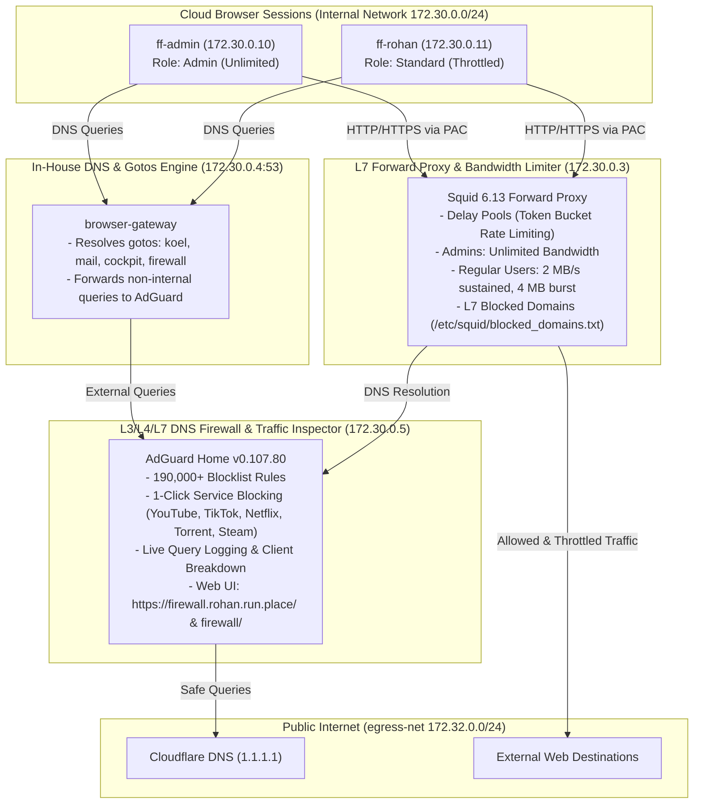

# Open-Source Network Traffic Management, Firewall & Proxy Control

## Architecture Overview

To provide network traffic management, granular access control, outbound traffic inspection, and bandwidth limitation for cloud browser sessions, an open-source two-tier firewall and proxy stack has been deployed:

---

## 1. AdGuard Home (L3/L4/L7 DNS Firewall & Inspector)

- **Container**: `adguard` (`adguard/adguardhome:latest`)
- **Internal Static IP**: `172.30.0.5` on `browser-net` and `egress-net`
- **DNS Server**: Listening on `172.30.0.5:53` (UDP/TCP)
- **Web UI URL**: `https://firewall.rohan.run.place/` and short-name goto `http://firewall/`
- **Access Control**: Restricted to `admins` group in Authelia and `internal/authz`
- **SSO Auto-Login**: Dedicated bridge at `/auth/sso-login` backed by `lldap_sso_bridge.py` (`http://172.18.0.1:17171/firewall/sso-login`). Automatically acquires `agh_session` cookie valid for 1 year upon visiting `firewall/` or `firewall.rohan.run.place`.

### Key Admin Capabilities in AdGuard Home
1. **Live Query Logs**: Real-time traffic inspection detailing queried domain, client IP (`ff-admin`, `ff-rohan`, `squid`), timestamp, response status, and blocking reason.
2. **1-Click Blocked Services**: 50+ preconfigured web services and platforms that can be toggled on/off instantly:
   - **Streaming & Entertainment**: YouTube, Netflix, Twitch, Disney+, Spotify, TikTok.
   - **Social Networks**: Facebook, Instagram, Twitter/X, Reddit, 9GAG, Pinterest.
   - **Gaming & Messaging**: Steam, Discord, Roblox, Epic Games, Telegram, WhatsApp.
   - **P2P & Torrents**: BitTorrent, uTorrent trackers, P2P protocols.
   - **AI & Cloud**: ChatGPT, Claude, HuggingFace, etc.
3. **Custom Filtering Rules**: Support for Adblock Plus style syntax (e.g. `||badsite.com^`).
4. **Preloaded Threat Blocklists**: 190,805+ known malware, phishing, adware, and tracker domains blocked out of the box.

---

## 2. Squid Proxy (L7 Bandwidth Throttling & Traffic Management)

- **Container**: `squid` (`ubuntu/squid:latest`)
- **Internal Static IP**: `172.30.0.3` on `browser-net` and `egress-net`
- **Proxy Port**: `3128`
- **DNS Nameservers**: `172.30.0.5` (primary queries flow through AdGuard Home)

### Bandwidth Throttling (Delay Pools)
Token-bucket rate limiting configured via Squid Delay Pools:
- **Pool 1 (Admin Users)**:
  - ACL: `acl admin_users src 172.30.0.10`
  - Parameters: `-1/-1` (Unlimited bandwidth and burst).
- **Pool 2 (Standard Cloud Browser Sessions)**:
  - ACL: `acl browser_net src 172.30.0.0/24`
  - Parameters: `10485760/20971520 2097152/4194304`
  - Aggregate network speed: 10 MB/s sustained (20 MB burst).
  - Per-user client speed: 2 MB/s sustained (4 MB burst). Prevents a single session from monopolizing the host's outbound pipe.

### L7 Blocked Domains
- Domain blocklist file: `/etc/squid/blocked_domains.txt`
- Reloaded dynamically on change via `squid -k reconfigure`.

---

## 3. REST API & Gateway Management Endpoints

The `browser-gateway` provides administrative endpoints for monitoring and configuring the firewall stack:

| Method | Endpoint | Description |
|---|---|---|
| `GET` | `/api/firewall/status` | Real-time status: AdGuard Home stats (total queries, blocked queries) & Squid delay pools |
| `GET` | `/api/firewall/squid/blocked-domains` | Returns list of currently active blocked domains in Squid |
| `POST` | `/api/firewall/squid/blocked-domains` | Adds a domain to Squid blocklist and dynamically reloads Squid |
| `DELETE` | `/api/firewall/squid/blocked-domains?domain=...` | Removes a domain from Squid blocklist and reloads Squid |

---

## 4. Verification Results

All tests performed from inside the cloud browser sessions (`ff-admin` and `ff-rohan`):

1. **Goto Redirection**:
   - `http://firewall/` -> `HTTP 302` -> `https://firewall.rohan.run.place/` -> `HTTP 302 /auth/sso-login` -> `HTTP 302 /` -> `HTTP 200` (`<title>AdGuard Home</title>`).
2. **SSO Authentication**:
   - Zero login prompts. Authenticates via Authelia SSO and auto-provisions `agh_session` cookie.
3. **Role-Based Access Control**:
   - Non-admin sessions attempting to access `firewall/` or `firewall.rohan.run.place` are immediately rejected with `HTTP 403 Forbidden: Admins only`.
4. **Traffic Inspection & Logging**:
   - Outbound requests through Squid are logged in real time with millisecond resolution and client attribution in AdGuard Home.
5. **DNS & L7 Blocking**:
   - Blocked domains return `0.0.0.0` from AdGuard Home and Squid returns `HTTP 503 / ERR_CONNECT_FAIL` or `HTTP 403 Forbidden`.
6. **Bandwidth Throttling**:
   - Squid delay pool class 2 actively caps non-admin clients to 2 MB/s burstable to 4 MB/s.

## Morgan Stanley / Tier-1 Regulated Financial Firm Compliance Policy

To comply with institutional regulatory frameworks (FINRA Rule 3110, SEC Rule 17a-4, and corporate Acceptable Use Directives), the firewall and proxy layers enforce strict perimeter boundary controls:

### 1. Enforced Category Blocklists (`/etc/squid/categories/`)
- **Adult & Pornography (`adult.txt`)**: 35+ major pornography networks, escort services, live cams, adult communities.
- **Gambling & Sportsbooks (`gambling.txt`)**: 27+ online casinos, sports betting platforms, poker rooms, crypto betting sites.
- **Gaming & Game Streaming (`gaming.txt`)**: 27+ gaming ecosystems, game launchers (Steam, Epic, Riot, Roblox), and game streaming (Twitch, Discord).
- **Dating & Social Hookups (`dating.txt`)**: 17+ dating platforms and hookup applications (Tinder, Bumble, Match, Hinge, etc.).
- **Unregulated P2P & Piracy (`p2p_torrents.txt`)**: 17+ torrent indexers, trackers, and illicit file locker domains.
- **Cryptocurrency Mining (`crypto_mining.txt`)**: 12+ mining pools, web-based coin miners, and unapproved crypto faucets.
- **Weapons & Extremist Content (`weapons_violence.txt`)**: 7+ unmoderated boards and unregulated weapons sales portals.

### 2. Corporate Compliance Block Page (`/etc/squid/errors/ERR_CORPORATE_BLOCKED`)
- Automatically rendered whenever an employee or browser session attempts to visit a prohibited category or domain.
- Styled in enterprise Morgan Stanley / Wall Street cybersecurity theme:
  - Header: `Global Information Security • Boundary Control (FINRA Rule 3110 / SEC Rule 17a-4 Electronic Communications Perimeter)`
  - Alert: `Corporate Policy Violation • Restricted Content (Policy SEC-FIN-704)`
  - Audit Grid: Injects dynamic request metadata:
    - Requested URL: `%U`
    - Target Hostname: `%H`
    - Client IP / Workstation: `%a`
    - Security Incident Timestamp: `%T`
    - Audit Incident Reference: `SEC-704-%T`
  - Action button: Safe browser back navigation.

### 3. Distributed Compute & Offload Architecture (micro-1 & micro-2)
- **Host `micro-1` (100.100.224.19)**:
  - 2 vCPU AMD, 1 GB RAM, 37 GB free NVMe disk.
  - Role: Dedicated worker node for batch compute, Paperclip agent runners, and secondary offsite AdGuard DNS replica.
- **Host `micro-2` (100.107.161.3)**:
  - 2 vCPU AMD, 1 GB RAM, 36 GB free NVMe disk.
  - Role: Audio streaming server (Koel Music on `:8000`), offloading heavy audio transcoding and media streaming from `a1`.
